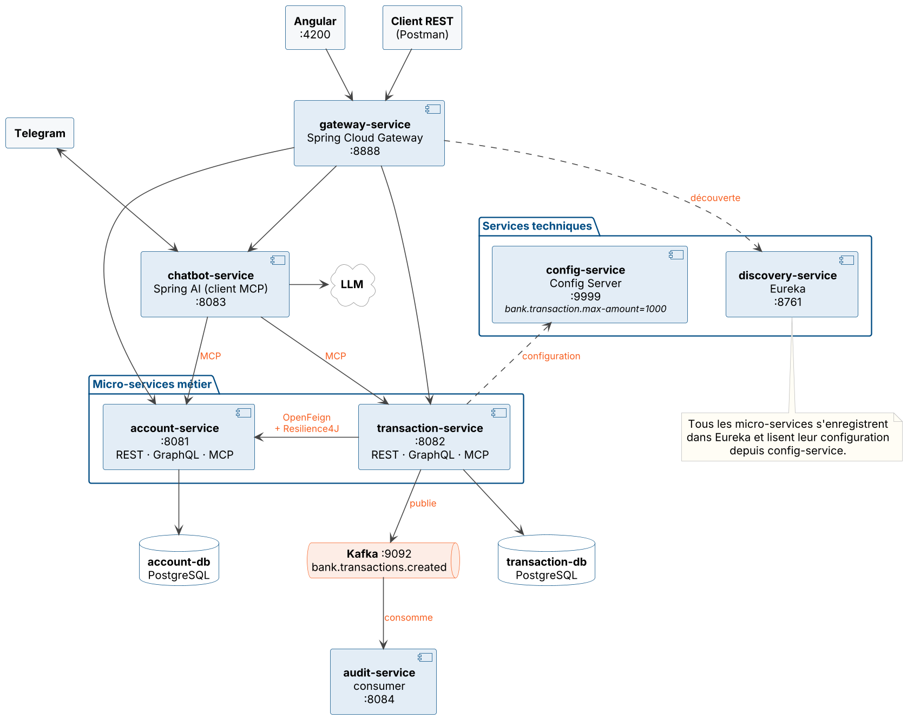

# Bank Platform — Microservices, AI & Full-stack

ENSET Mohammedia × ADRIA Business & Technology — technical selection test (PFE 2027).

**Author:** Yousef ELHAID — GLSID, ENSET Mohammedia

A banking platform built with **Spring Cloud** microservices: accounts, transactions with business rules,
service-to-service calls with **OpenFeign + Resilience4J**, service discovery, an API gateway,
and an **AI agent** (Spring AI) that performs banking operations through **MCP** tools.

---

## Architecture



Class diagram: [`docs/diagrams/class-diagram.png`](docs/diagrams/class-diagram.png) ·
Transaction flow: [`docs/diagrams/transaction-sequence.png`](docs/diagrams/transaction-sequence.png)
(PlantUML sources in the same folder).

## Progress

| Part | Content | Status |
|---|---|---|
| A | Repository, multi-module Maven project, report | ✅ |
| B | Class diagram, architecture diagram | ✅ |
| C1 | `account-service` — REST, GraphQL, MCP | ✅ |
| C2 | `transaction-service` — REST, GraphQL, MCP | ✅ (see known issues) |
| C3 | OpenFeign + Resilience4J, transfer between accounts | ✅ |
| D | Eureka discovery, Spring Cloud Gateway | ✅ (config-service not done) |
| E | AI agent (Spring AI + MCP client), tested with a REST client | ✅ |
| F | Kafka events | ⏳ |
| G | Web client (Angular) | ⏳ |
| H | Fraud detection (Python) | ⏳ |
| I | DevOps (Dockerfiles, compose, CI/CD) | ⏳ |

## Services

| Service | Port | Role |
|---|---|---|
| `discovery-service` | 8761 | Eureka registry |
| `gateway-service` | 8888 | Single entry point, routes through Eureka |
| `account-service` | 8081 | Bank accounts — REST, GraphQL, MCP |
| `transaction-service` | 8082 | Transactions and transfers — REST, GraphQL, MCP |
| `chatbot-service` | 8083 | AI agent (Spring AI, MCP client) |
| `account-db` | 5437 | PostgreSQL 18 (Docker) |
| `transaction-db` | 5438 | PostgreSQL 18 (Docker) |

## Tech stack

| Area | Technologies |
|---|---|
| Language / framework | Java 21, Spring Boot 4.1.2 |
| Microservices | Spring Cloud Gateway, Eureka, OpenFeign, Resilience4J |
| APIs | REST, GraphQL (Spring for GraphQL), MCP (Spring AI MCP server) |
| AI | Spring AI, LLM through an OpenAI-compatible API (Groq) |
| Data | PostgreSQL, Spring Data JPA |
| Tools | Maven, Docker Compose, Lombok, PlantUML |

## Project structure

```
elhaid-yousef-test-adria-pfe-27/
├── pom.xml                  # aggregator (one module per microservice)
├── docker-compose.yml       # PostgreSQL databases
├── .env.example             # environment variables template
├── account-service/
├── transaction-service/
├── discovery-service/
├── gateway-service/
├── chatbot-service/
└── docs/
    ├── diagrams/            # PlantUML sources + PNG
    └── screenshots/         # test screenshots
```

Each business service follows the same layers. REST, GraphQL and MCP all call the **same service layer**:

```
domain/  repository/  service/  web/rest/  web/graphql/  mcp/
```

## Business rules

Applied in `transaction-service` for every transaction:

- the amount is strictly positive and ≤ `bank.transaction.max-amount` (1000);
- the account exists and is `ACTIVE` (checked through OpenFeign);
- the transaction currency matches the account currency;
- a `DEBIT` requires enough balance;
- after the transaction is saved, the account balance is updated (debit or credit);
- a **transfer** creates a `DEBIT` on the source account and a `CREDIT` on the target account (same currency).
  If the credit fails, the source account is refunded (compensation).

## Fault tolerance

`transaction-service` calls `account-service` through an OpenFeign client protected by a Resilience4J circuit breaker
(window of 10 calls, opens at 50% failures, stays open 10 s, 3 s timeout).

The fallback **never returns a fake account**: it turns the failure into a clear refusal
(404 account not found, 503 `account-service` unavailable) and the transaction is rolled back.

## Getting started

**Prerequisites:** Java 21, Maven, Docker.

```bash
cp .env.example .env          # then set real passwords and GROQ_API_KEY
docker compose up -d          # account-db and transaction-db
```

Start the services in this order (from IntelliJ or `mvn spring-boot:run` in each module):

1. `discovery-service` → <http://localhost:8761>
2. `account-service` (creates 4 test accounts on first start)
3. `transaction-service`
4. `chatbot-service` (needs the two MCP servers to be up)
5. `gateway-service`

## API

All business endpoints are also available through the gateway: `http://localhost:8888`.

### account-service

| Method | URL | Description |
|---|---|---|
| GET | `/api/accounts` | List accounts |
| GET | `/api/accounts/{id}` | Get one account |
| POST | `/api/accounts` | Create an account |
| PATCH | `/api/accounts/{id}/status?status=ACTIVE\|BLOCKED` | Activate / block |
| POST | `/api/accounts/{id}/debit` | Debit `{"amount": 100}` |
| POST | `/api/accounts/{id}/credit` | Credit `{"amount": 100}` |

GraphQL: `POST /graphql` (GraphiQL UI at `/graphiql`) — queries `accounts`, `accountById`;
mutations `createAccount`, `changeStatus`, `debit`, `credit`.

MCP (`/mcp`): `getAllAccounts`, `getAccountById`, `createAccount`, `changeAccountStatus`.
Debit and credit are not exposed to the agent: money moves go through `transaction-service`.

### transaction-service

| Method | URL | Description |
|---|---|---|
| GET | `/api/transactions` | List transactions |
| GET | `/api/transactions/{id}` | Get one transaction |
| GET | `/api/transactions/account/{accountId}` | Transactions of an account |
| POST | `/api/transactions` | Create a transaction (payment or credit) |
| POST | `/api/transactions/transfer` | Transfer between two accounts |

MCP (`/mcp`): `getAllTransactions`, `getTransactionById`, `getTransactionsByAccount`, `createTransaction`, `transfer`.

### chatbot-service

| Method | URL | Description |
|---|---|---|
| GET | `/chat?query=...&conversationId=...` | Ask the AI agent (`conversationId` defaults to `web`) |

### Examples

```bash
curl http://localhost:8888/api/accounts

curl -X POST http://localhost:8888/api/transactions \
  -H "Content-Type: application/json" \
  -d '{"accountId":"<account-id>","amount":100,"currency":"EUR","merchantCategory":"GROCERY","country":"FR"}'

curl -X POST http://localhost:8888/api/transactions/transfer \
  -H "Content-Type: application/json" \
  -d '{"sourceAccountId":"<source-id>","targetAccountId":"<target-id>","amount":50}'

curl "http://localhost:8888/chat?query=List%20all%20the%20accounts%20with%20their%20balance"
```

Errors use the standard `ProblemDetail` format:

```json
{ "status": 400, "detail": "Amount exceeds the maximum allowed: 1000" }
```

## Known issues / not done yet

- `transaction-service` GraphQL: schema and controller are written, but the endpoint does not answer yet.
- `config-service` is not implemented: `bank.transaction.max-amount` is set in `transaction-service`'s `application.yaml`.
- `balance` is a `double`, as required by the given model; `BigDecimal` would be safer for money.
- Parts F, G, H and I are not done yet.

## Report

The PDF report with the answers and the test screenshots is in [`docs/rapport.pdf`](docs/rapport.pdf).
